# Tasks

Meta-World's 50 v3 tasks as POMDPs, made with `jax_pomdps.make("metaworld.env:<name>")`, named as in Meta-World
without "-v3". Every task is Meta-World's: its scene, reset distribution, observation, reward, and success check,
re-expressed in JAX on MuJoCo Warp. The descriptions are Meta-World's; the images show the first state of an episode
and its state when Meta-World's scripted policy succeeds.

Each task is registered in each observation mode as `name/<mode>`, and as `name` in the default mode, `mkv`:

- `name/mkv`, observing Meta-World's 39-vector with the goal: close to a Markov state, enough for an agent that sees
  one observation at a time;
- `name/pix`, observing `corner2_image`, an 84×84 uint8 image of the `corner2` camera, which shows the goal as
  Meta-World's images do, with its site marker;
- `name/pix-prp`, observing that image and `proprio`, the hand position and gripper opening at this step and the
  previous one.

Proprioception alone shows neither the objects nor the goal, so there is no `prp` mode. Meta-World's ML benchmarks
hide the goal, which an agent can only infer from rewards over episodes; `goal_observable=False` gives that
observation, which is not a registered mode.

`camera_names`, `camera_height`, and `camera_width` change the cameras, and every other argument of
`MetaworldPOMDP` (such as `max_worlds` or `physics`) passes through.

All tasks share these conventions:

- **Actions** are 4 values in [-1, 1]: a displacement of the hand's mocap target of up to 1 cm per axis, and the
  gripper's effort, positive closing it.
- **Control** runs at 80 Hz, Meta-World's rate. Each step is 3 substeps of 4.17 ms by default (`physics="fast"`),
  or Meta-World's 5 substeps of 2.5 ms with `physics="upstream"`.
- **Observations** are Meta-World's 39-vector: the hand position, the gripper opening, the positions and quaternions
  of up to two objects (padded with zeros to 14 values), the same 18 values at the previous step, and the goal
  position. Quaternions are as Meta-World observes them, (x, y, z, w) or MuJoCo's (w, x, y, z) depending on the task.
- **Reward** is Meta-World's v2 reward, at most 10; `evaluate` also returns Meta-World's info dict.
- **Episodes** never end on their own unless `terminate_on_success=True`; Meta-World's horizon is
  `MAX_PATH_LENGTH` = 500 steps, left to the caller.
- **Initial states** follow Meta-World's reset: the hand moves to its initial position, then the task places its
  objects and goal from a random reset vector drawn from the task's reset space.

## `assembly`

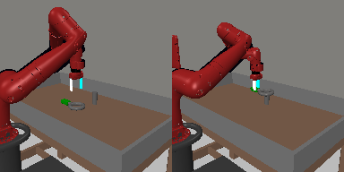

**Assemble nut.** Pick up a nut and place it onto a peg. Randomize nut and peg positions.

## `basketball`

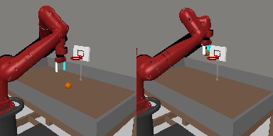

**Basketball.** Dunk the basketball into the basket. Randomize basketball and basket positions.

## `bin-picking`

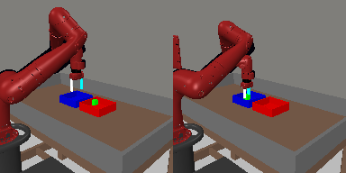

**Pick bin.** Grasp the puck from one bin and place it into another bin. Randomize puck positions.

## `box-close`

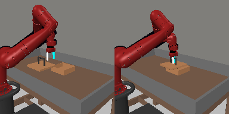

**Close box.** Grasp the cover and close the box with it. Randomize the cover and box positions.

## `button-press`

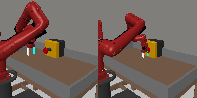

**Press button.** Press a button. Randomize button positions.

## `button-press-topdown`

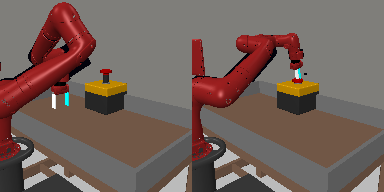

**Press button top.** Press a button from the top. Randomize button positions.

## `button-press-topdown-wall`

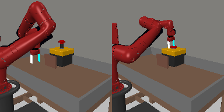

**Press button top wall.** Bypass a wall and press a button from the top. Randomize button positions.

## `button-press-wall`

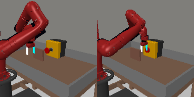

**Press button wall.** Bypass a wall and press a button. Randomize the button positions.

## `coffee-button`

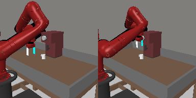

**Get coffee.** Push a button on the coffee machine. Randomize the position of the coffee machine.

## `coffee-pull`

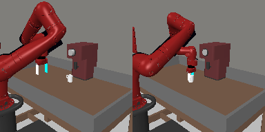

**Pull mug.** Pull a mug from a coffee machine. Randomize the mug and the machine positions.

## `coffee-push`

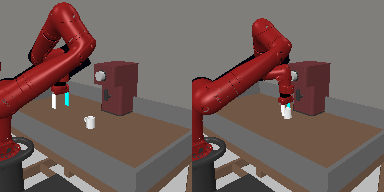

**Push mug.** Push a mug under a coffee machine. Randomize the mug and the machine positions.

## `dial-turn`

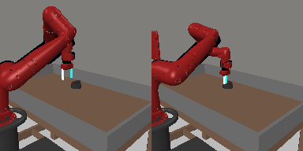

**Turn dial.** Rotate a dial 180 degrees. Randomize dial positions.

## `disassemble`

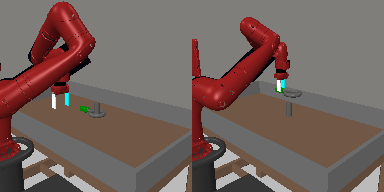

**Disassemble nut.** Pick a nut out of the a peg. Randomize the nut positions.

## `door-close`

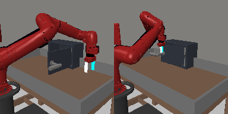

**Close door.** Close a door with a revolving joint. Randomize door positions.

## `door-lock`

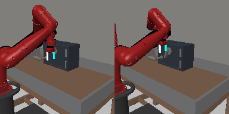

**Lock door.** Lock the door by rotating the lock clockwise. Randomize door positions.

## `door-open`

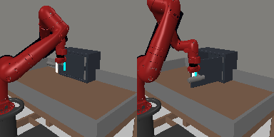

**Open door.** Open a door with a revolving joint. Randomize door positions.

## `door-unlock`

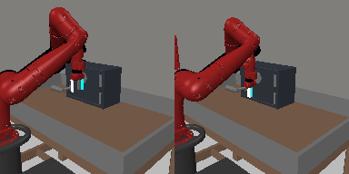

**Unlock door.** Unlock the door by rotating the lock counter-clockwise. Randomize door positions.

## `drawer-close`

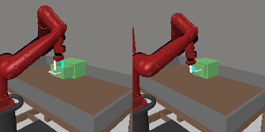

**Close drawer.** Push and close a drawer. Randomize the drawer positions.

## `drawer-open`

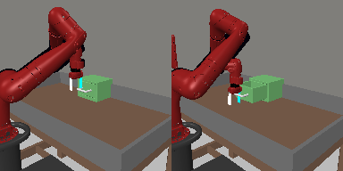

**Open drawer.** Open a drawer. Randomize drawer positions.

## `faucet-close`

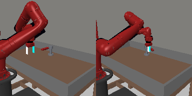

**Turn off faucet.** Rotate the faucet clockwise. Randomize faucet positions.

## `faucet-open`

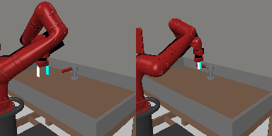

**Turn on faucet.** Rotate the faucet counter-clockwise. Randomize faucet positions.

## `hammer`

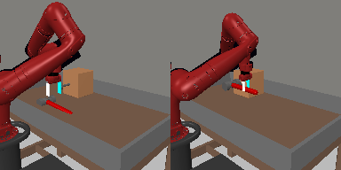

**Hammer.** Hammer a screw on the wall. Randomize the hammer and the screw positions.

## `hand-insert`

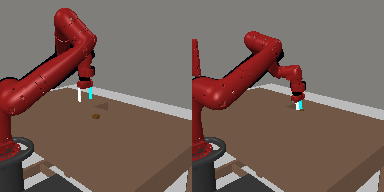

**Insert hand.** Insert the gripper into a hole..

## `handle-press`

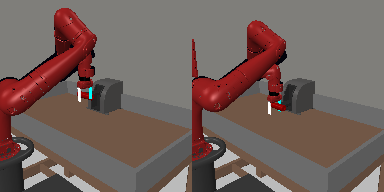

**Press handle.** Press a handle down. Randomize the handle positions.

## `handle-press-side`

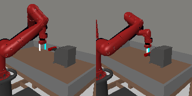

**Press handle side.** Press a handle down sideways. Randomize the handle positions.

## `handle-pull`

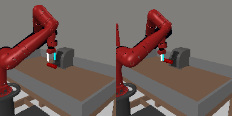

**Pull handle.** Pull a handle up. Randomize the handle positions.

## `handle-pull-side`

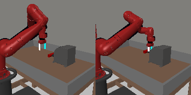

**Pull handle side.** Pull a handle up sideways. Randomize the handle positions.

## `lever-pull`

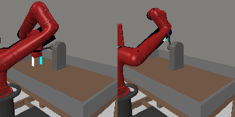

**Pull lever.** Pull a lever down 90 degrees. Randomize lever positions.

## `peg-insert-side`

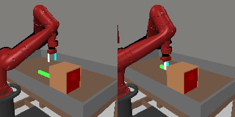

**Insert peg side.** Insert a peg sideways. Randomize peg and goal positions.

## `peg-unplug-side`

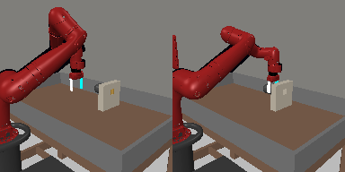

**Unplug peg.** Unplug a peg sideways. Randomize peg positions.

## `pick-out-of-hole`

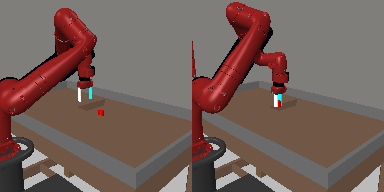

**Pick out of hole.** Pick up a puck from a hole. Randomize puck and goal positions.

## `pick-place`

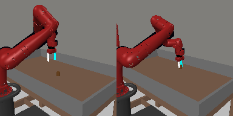

**Pick&place.** Pick and place a puck to a goal. Randomize puck and goal positions.

## `pick-place-wall`

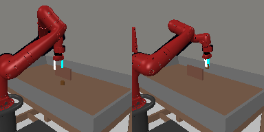

**Pick&place w/ wall.** Pick a puck, bypass a wall and place the puck. Randomize puck and goal positions.

## `plate-slide`

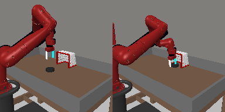

**Slide plate.** Slide a plate into a cabinet. Randomize the plate and cabinet positions.

## `plate-slide-back`

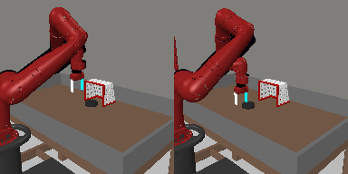

**Retrieve plate.** Get a plate from the cabinet. Randomize plate and cabinet positions.

## `plate-slide-back-side`

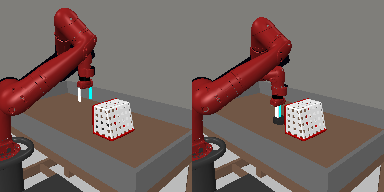

**Retrieve plate side.** Get a plate from the cabinet sideways. Randomize plate and cabinet positions.

## `plate-slide-side`

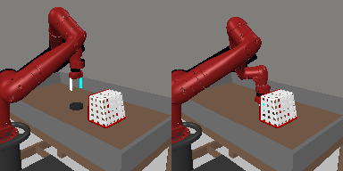

**Slide plate side.** Slide a plate into a cabinet sideways. Randomize the plate and cabinet positions.

## `push`

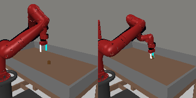

**Push.** Push the puck to a goal. Randomize puck and goal positions.

## `push-back`

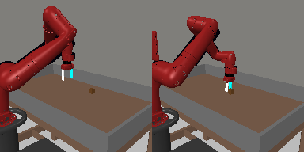

**Pull.** Pull a puck to a goal. Randomize puck and goal positions.

## `push-wall`

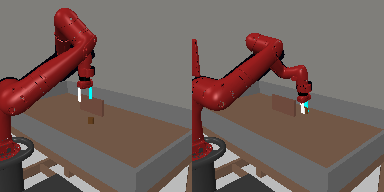

**Push with wall.** Bypass a wall and push a puck to a goal. Randomize puck and goal positions.

## `reach`

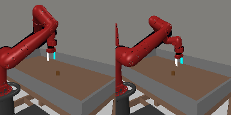

**Reach.** Reach a goal position. Randomize the goal positions.

## `reach-wall`

**Reach with wall.** Bypass a wall and reach a goal. Randomize goal positions.

## `shelf-place`

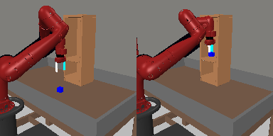

**Place onto shelf.** Pick and place a puck onto a shelf. Randomize puck and shelf positions.

## `soccer`

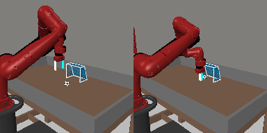

**Soccer.** Kick a soccer into the goal. Randomize the soccer and goal positions.

## `stick-pull`

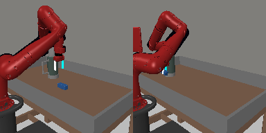

**Pull with stick.** Grasp a stick and pull a box with the stick. Randomize stick positions.

## `stick-push`

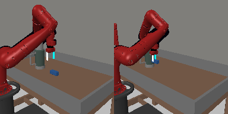

**Push with stick.** Grasp a stick and push a box using the stick. Randomize stick positions..

## `sweep`

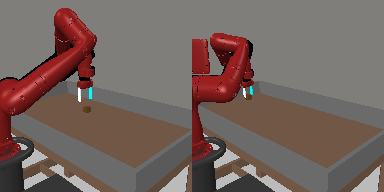

**Sweep.** Sweep a puck off the table. Randomize puck positions.

## `sweep-into`

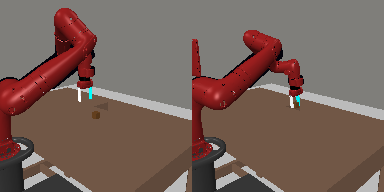

**Sweep into hole.** Sweep a puck into a hole. Randomize puck positions.

## `window-close`

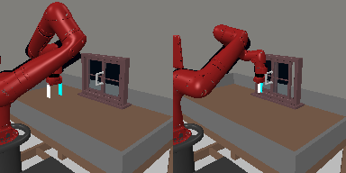

**Close window.** Push and close a window. Randomize window positions.

## `window-open`

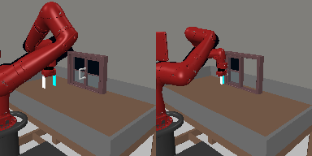

**Open window.** Push and open a window. Randomize window positions.
